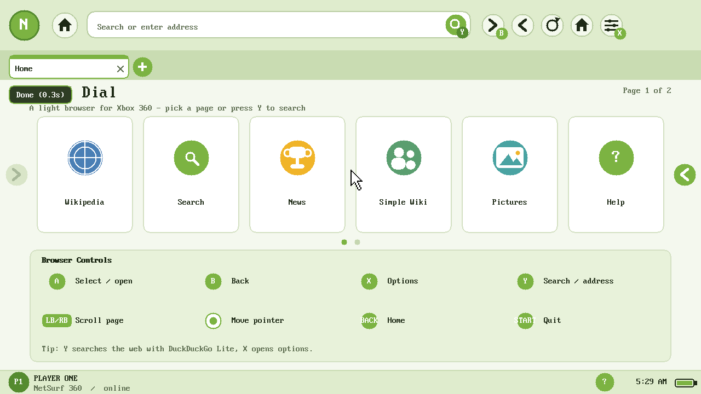

# xenon-netsurf — NetSurf on the Xbox 360

> **Experimental / work in progress. This port is not complete.** It has only
> been tested in the Xenia emulator; expect crashes, missing pages and breaking
> changes. Video playback, YouTube and AAC audio are not implemented. Do not
> sign in to Xbox LIVE on a BadUpdate console.

A browser port of [NetSurf](https://www.netsurf-browser.org/) 3.11 to the Xbox
360 (Xenon, 733 MHz PowerPC, 512 MB shared RAM) using the
[xsdk](https://github.com/xenosworks/xsdk) toolchain. It renders real HTML 4 and
CSS 2.1 at 1280×720, with no JavaScript.

Status: **validated in Xenia; the current UI revision has not been run on
hardware yet.**



## Download

The prebuilt package is in [Releases](https://github.com/dfsf2151/xenon-netsurf/releases)
and in [`release/ns360.zip`](release/ns360.zip). Copy the `ns360` folder to a
FAT32 USB drive and launch `default.xex` from Aurora. The package includes the
user guide, CA bundle, Speed Dial files, `demo.wav` and `demo.mp3`.

| Step | What | Where | Result |
|------|------|-------|--------|
| S1 | Build NetSurf + libcss/libdom/libhubbub for PowerPC | host | done |
| S2 | Render a local page to the framebuffer | Xenia | done, 1280×720 |
| S3 | Fetch over HTTP and render | Xenia (LAN) | done: GET, 302, chunked, relative CSS |
| S4 | Console run: timing and RAM | Xbox 360 | done for the early render/HTTP build |
| S5 | HTTPS with checked certificates, interactive UI, tabs, search | Xenia | done |
| S6 | Local audio (WAV/MP3) and H.264 Main/High decode measurement | Xenia | done |

## What works

- NetSurf's HTML parser (libhubbub), DOM (libdom), CSS cascade (libcss), layout
  and redraw, linked statically into an 8.3 MB XEX.
- Inline CSS, external CSS (relative URLs), tables, lists, links, forms, colours,
  borders and backgrounds.
- HTTP/1.1 and HTTPS (mbedTLS, TLS 1.2) with mandatory certificate checking
  against the bundled `cacert.pem`; keep-alive pool of six connections; chunked
  bodies and redirects.
- PNG, JPEG, GIF and BMP, including transparency and downscaling at decode time.
- Dashboard UI: green toolbar, address/search bar, tabs (up to six, each with its
  own scroll position), Speed Dial (two pages), status bar, on-screen keyboard
  and Options menu.
- Gamepad control through XAM: A open, B back, X menu, Y address bar, LB/RB
  scroll, BACK home, START quit.
- DuckDuckGo Lite search from the address bar; no JavaScript required.
- Local WAV (PCM 16-bit) and MP3 playback through the kernel XAudio render
  driver at 48 kHz, mixed to the front stereo pair. Open **Options** with X
  and choose **Play demo.wav**, **Play demo.mp3** or **Sound Test**.
- Deterministic input scripts (`input.txt`) and framebuffer dumps for Xenia
  testing.

## What does not work yet

- **Video playback in the browser.** OpenH264 has been cross-built and measured
  on Xenia, but it is not linked into the browser. MP4 demuxing, HTTP video
  download, a fullscreen presenter and audio/video sync remain.
- **YouTube.** Its 360p stream is H.264 Main/CABAC, which the old h264bsd
  decoder could not parse; OpenH264 now can. Public stream extraction is also
  blocked by YouTube's bot check on many networks, so direct-MP4 sites are the
  nearer target. Sites such as `test-videos.co.uk`, W3Schools and `archive.org`
  serve plain H.264 Main/High MP4 files without JavaScript.
- **AAC audio.** No AAC decoder is linked, so YouTube/MP4 audio is silent even
  once video works. MP3 and PCM WAV only.
- **HTTP audio/video streams and page media elements.** Audio files are played
  from the Options menu or a local `file:///game:/…` address, not from a web
  page player.
- **JavaScript.** Compiled out; NetSurf's JS support is a stub anyway.
- **SVG.** No rasteriser; Wikimedia's PNG thumbnails render, but direct SVG
  images appear as empty boxes.
- **Arabic and other non-ASCII scripts.** The fixed 8×16 font is ASCII; unknown
  code points render as `?`. Punctuation is folded to ASCII where possible.
- **Xbox LIVE.** Deliberately never contacted. Do not sign in on BadUpdate.
- **Robust HTTP timeouts and cancellation.** The fetcher uses blocking sockets.

## Measurements

### OpenH264, decode only (Xenia, 300-frame clips, one thread)

| Clip | Profile | Decode |
|------|---------|--------|
| 640×360 | Main, CABAC, 3 B-frames | **157.5 fps** |
| 854×480 | Main, CABAC, 3 B-frames | **92.4 fps** |
| 1280×720 | High, CABAC, 3 B-frames | **42.7 fps** |

Zero decode errors. The picture-150 YUV dumps match `ffmpeg` byte for byte.
These are emulator numbers; the earlier h264bsd console run was roughly half the
Xenia decode rate, so 360p/480p should still clear 30 fps on hardware, while
720p High is likely borderline. Console measurement of this port is pending.

### Audio (Xenia)

- XAudio render client registered; the emulator pulled frames through the
  callback (400 frames = about 2.1 seconds in one test).
- MP3 PCM compared with `ffmpeg`: maximum difference 1 LSB over 133,182 samples,
  confirming the big-endian output path.
- WAV PCM 16-bit and a generated 660 Hz tone both play.

### Browser (Xenia, early build)

- Local page: first paint 508 ms.
- HTTP page (LAN): first paint 508 ms; fetch about 2 ms.
- Wikipedia article over HTTPS: complete load 24.5 s with images on the test
  network; text and images render, tabs and scroll work.
- Heap after a full Wikipedia render: about 22 MB.

### Browser (Xbox 360, early build)

- Local page: first redraw 7.4 s, complete 8.7 s.
- HTTP page: first redraw 7.6 s, complete 8.9 s.
- Presented frame scanout: 23.4 ms.
- The console framebuffer was bit-identical to Xenia for the early local/HTTP
  page.

## Layout

```
frontends/xenon/             the port itself
  main.c                     startup, render loop, heap figures
  browser.c                  browser_window + gui_window glue, tabs
  plot.c                     plotters -> framebuffer, overlay, screenshots
  ui.c                       toolbar, Speed Dial, menu, address bar, OSK
  http.c                     HTTP/HTTPS fetcher on xsdk sockets + mbedTLS
  fetch.c                    filetype, resource: URLs, fetcher glue
  audio.c                    XAudio output, WAV/MP3 decode and resampling
  minimp3/                   minimp3 headers (CC0)
  input.c                    XAM pad + input.txt test scripts
  time.c                     Date-header clock and uptime
  font8x16.c                 ASCII font from Linux (GPL-2)
patches/                     changes to the NetSurf tree
config/                      Makefile.config example
release/ns360.zip            packaged build
screenshots/                 framebuffer captures from Xenia

netsurf-src/ deps/ prefix/ third_party/   local build workspace, not committed
```

## Build

Full notes: [`docs/BUILDING.md`](docs/BUILDING.md).

Needs the xsdk toolchain at `~/xsdk-gcc` (GCC 15.3, `-mcpu=cell`, newlib) and the
xsdk checkout at `../UCN_MVP_X360/third_party/xsdk`.

```sh
# NetSurf source at the tested commit
git clone https://github.com/netsurf-browser/netsurf.git netsurf-src
git -C netsurf-src checkout 39da3c3a40af4566d86500ff3052dfdc7f9a0378
git -C netsurf-src apply ../patches/netsurf-xenon.patch
cp -r frontends/xenon netsurf-src/frontends/
cp config/Makefile.config.example netsurf-src/Makefile.config   # edit paths

# Dependency libraries: see docs/BUILDING.md for the tested versions
./build_deps.sh
PKG_CONFIG_PATH=$PWD/prefix/lib/pkgconfig \
  make -C netsurf-src TARGET=xenon PREFIX=$PWD/prefix -j8

python3 ../UCN_MVP_X360/third_party/xsdk/tools/elf2xex.py \
  netsurf-src/nsxenon ns360/default.xex
```

Dependency notes: libhubbub's build uses a small `gperf` stand-in; utf8proc is
built by hand. The Xenon target disables curl, OpenSSL, JS and SVG.

## Run

### Emulator

```sh
APPIMAGE_EXTRACT_AND_RUN=1 \
  /path/to/xenia_edge_linux.AppImage release/ns360/default.xex
```

`game:\` is the folder holding the XEX, so `res/`, `demo.wav` and `demo.mp3`
must sit beside it. Log: `~/.local/share/Xenia/cache/default.log`.

### Console

1. Extract `release/ns360.zip`, then copy the `ns360` folder to a FAT32 USB
   stick, e.g. `Games/ns360/`.
2. Launch `default.xex` from Aurora.
3. The Speed Dial appears. Press X for Options, including the audio tests.

Do not sign in to Xbox LIVE on a BadUpdate console.

## Next

1. Wire OpenH264 into the browser: MP4 (ISO BMFF/avcC) demux, bounded HTTP
   download, fullscreen YUV→RGB presentation (GPU shader preferred), B to stop.
2. Add AAC decoding (faad2 or equivalent) and audio/video clock sync.
3. Test direct MP4 sites end to end; only then revisit YouTube's InnerTube
   endpoints and their bot/consent requirements.
4. Console run of the current UI revision and video path.

NetSurf is GPL-2; this frontend and the font carry the same licence. minimp3 is
CC0. OpenH264 (BSD) is used by the separate decode benchmark. See `NOTICE` for
the other components.
