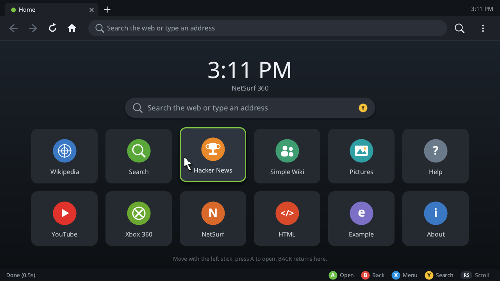
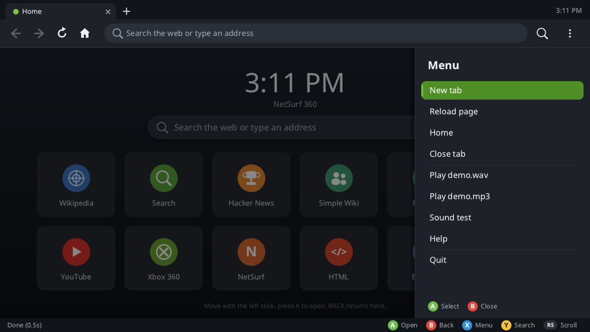
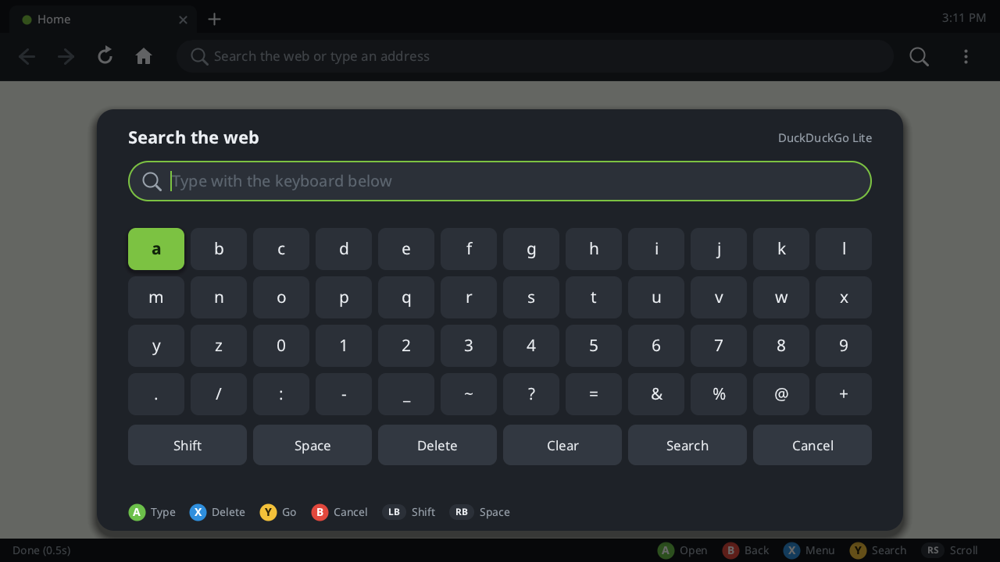
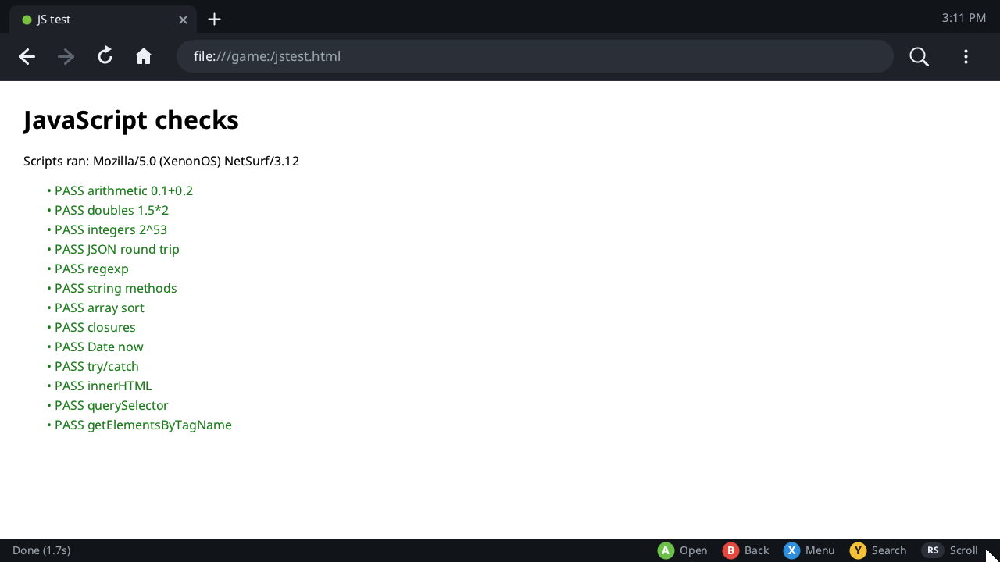
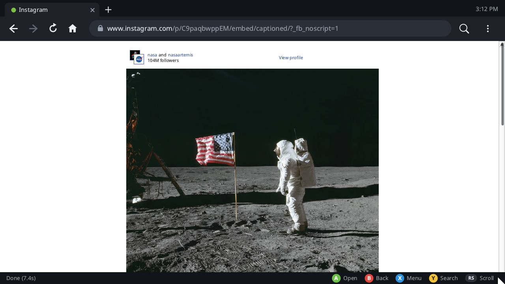
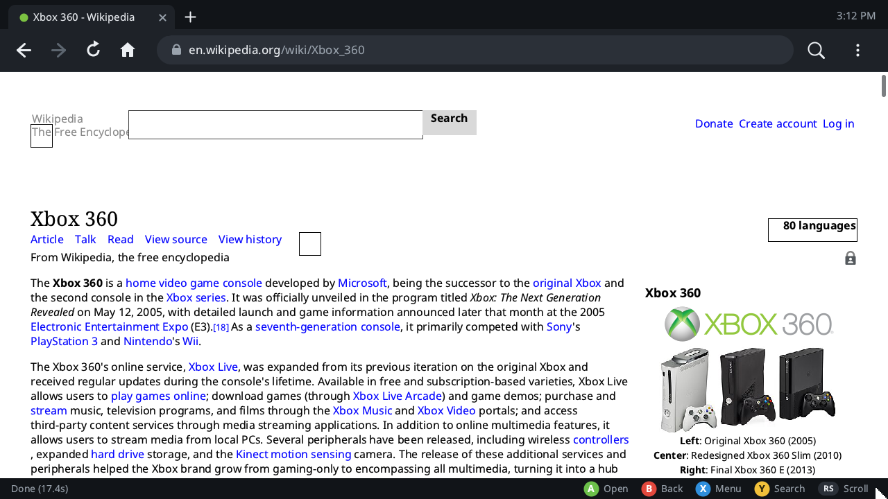

# xenon-netsurf — NetSurf on the Xbox 360

> **Experimental / work in progress.** It has been tested in the Xenia emulator;
> the current revision has not been run on hardware yet. Expect crashes,
> missing pages and breaking changes. Do not sign in to Xbox LIVE on a
> BadUpdate console.

A port of the [NetSurf](https://www.netsurf-browser.org/) browser to the Xbox
360 (Xenon, 3.2 GHz PowerPC, 512 MB shared RAM), built with the
[xsdk](https://github.com/xenosworks/xsdk) toolchain. It renders HTML and CSS at
1280×720 with anti-aliased Noto fonts, runs ECMAScript 5 through Duktape, and
is driven entirely with the controller.



## Download

The prebuilt package is in [`release/ns360.zip`](release/ns360.zip)
(checksums in [`release/SHA256SUMS`](release/SHA256SUMS)). Copy the `ns360`
folder to a FAT32 USB drive and launch `default.xex` from Aurora. The package
includes the fonts, the user guide, the CA bundle, the Speed Dial pages,
`demo.wav`, `demo.mp3` and a JavaScript self-test page (`jstest.html`).

## What's new in this revision

- **Fonts.** The 8×16 bitmap font is gone. Text is drawn from Noto Sans, Noto
  Serif and Noto Sans Mono (regular, bold, italic) through stb_truetype, with a
  glyph cache, at the sizes the page asks for.
- **New interface.** A dark tab strip and toolbar with a pill address bar
  (host bright, path dimmed, lock on HTTPS), a loading bar, a Speed Dial with
  a clock and twelve tiles, a slide-in menu, a larger on-screen keyboard and a
  status line with controller hints. Every shape is anti-aliased.
- **JavaScript.** Duktape (ECMAScript 5.1) with NetSurf's DOM bindings is on.
  A script gets 5 seconds before it is stopped. A page without scripts or
  `on*` handlers never builds a JavaScript heap, so plain pages pay nothing.
- **Forms and sign-in.** The fetcher sends POST (URL-encoded and multipart),
  sends and stores cookies, and keeps them in `Cookies` beside the XEX between
  runs. Pressing A on a text field opens the keyboard with the field's text;
  password fields show dots; Done fills the field without submitting.
- **Speed.** Moving the pointer rewrites only the screen tiles under it
  (about 10 ms a frame in Xenia, from about 70 ms). Scrolling moves the page
  pixels and draws only the strip that came into view. Verbose logging is off
  unless `debug.txt` sits beside the XEX.
- **Scrolling.** LB/RB scroll a screen, the right stick scrolls smoothly, and a
  thumb at the right edge shows the position. (LB/RB did not scroll the page
  before.)
- **Instagram posts.** Links to public posts and reels open Instagram's
  server-rendered embed page: the picture, the caption and the like count.
  Scripts are turned off on Instagram and Facebook (`nojs.txt` changes the
  list), and stylesheets over 512 KB are skipped.
- **Fixes.** The left stick's vertical axis was inverted. An empty inline
  `<style>` could stop a page from ever finishing (a NetSurf bug, fixed in
  `css.c`). Forms on pages not in UTF-8 could not be submitted (the iconv shim
  could only decode).

| | |
|---|---|
|  |  |
|  |  |



## Controls

| Input | Action |
|---|---|
| A | Open a link, tile or button; on a text field, open the keyboard |
| B | Back |
| X | Menu (tabs, reload, home, audio, help, quit) |
| Y | Search or address |
| Left stick / D-pad | Move the pointer |
| Right stick | Scroll smoothly |
| LB / RB | Scroll a screen up / down |
| BACK | Speed Dial |
| START | Quit |

On the keyboard: A types, X deletes, Y is Go (address bar) or Done (page
field), B cancels, LB is Shift and RB is Space.

## What works

- NetSurf's HTML parser (libhubbub), DOM (libdom), CSS cascade (libcss),
  layout and redraw, linked statically into one XEX.
- HTTP/1.1 and HTTPS (mbedTLS, TLS 1.2) with mandatory certificate checking
  against the bundled `cacert.pem`; a keep-alive pool; chunked bodies and
  redirects; GET and POST; cookies.
- JavaScript: ES5 with a partial DOM (`getElementById`, `querySelector`,
  `createElement`, `innerHTML`, events, `setTimeout`). `jstest.html` runs the
  checks: 14 of 15 pass in Xenia (`DOMContentLoaded` doesn't fire).
- PNG, JPEG, GIF and BMP, with transparency.
- Up to six tabs, each with its own page, history and scroll position.
- DuckDuckGo Lite search from the address bar.
- Local WAV (PCM 16-bit) and MP3 playback through XAudio at 48 kHz.
- Deterministic input scripts (`input.txt`) and framebuffer dumps for testing
  in Xenia.

## What does not work

- **Modern web apps.** YouTube, the Instagram feed and other sites built on
  ES2015+ frameworks need far more than ES5 and NetSurf's DOM. YouTube shows
  only its skeleton.
- **Instagram sign-in.** The form is sent, but Instagram answers with the same
  page: it only signs in through its own scripts (a CSRF header and a password
  encrypted in the browser). The feed and profile post lists are built by
  scripts too. Public posts and reels work without an account.
- **Video and AAC audio.** OpenH264 is cross-built and measured but not linked
  into the browser.
- **SVG**, file uploads (multipart sends the file name only) and Arabic or
  other scripts outside Latin, Greek and Cyrillic.
- **Robust HTTP timeouts.** The fetcher uses blocking sockets.

## Measurements (Xenia)

| | Before | Now |
|---|---|---|
| First paint of the Speed Dial | 1.5 s | 0.4–0.6 s |
| Present after a pointer move | ~70 ms | ~10 ms |
| Wikipedia article, complete | 23.9 s | 19.2 s |
| Instagram post page | never finished | 6.4 s |

These are emulator numbers. The console has not been measured with this
revision.

## Layout

```
frontends/xenon/             the port itself
  main.c                     startup, render loop, damage tracking, cookie jar
  browser.c                  browser_window + gui_window glue, tabs, scrolling
  plot.c                     plotters, page buffer, compose and tiled present
  draw.c                     anti-aliased chrome shapes and UI text
  font.c                     Noto faces through stb_truetype, glyph cache
  layout.c                   text measuring for NetSurf's layout
  ui.c                       tabs, toolbar, Speed Dial, menu, keyboard, status
  http.c                     HTTP/HTTPS fetcher: GET, POST, cookies
  iconv.c                    UTF-8, Latin-1, Windows-1252, UTF-16 both ways
  input.c                    XAM pad + input.txt test scripts
  audio.c                    XAudio output, WAV/MP3 decode and resampling
  stb/stb_truetype.h         stb_truetype 1.26 (MIT / public domain)
  minimp3/                   minimp3 headers (CC0)
patches/                     changes to the NetSurf tree
config/                      Makefile.config example
release/ns360.zip            packaged build
screenshots/                 framebuffer captures from Xenia
```

## Build

Full notes: [`docs/BUILDING.md`](docs/BUILDING.md).

Needs the xsdk toolchain at `~/xsdk-gcc` (GCC 15.3, `-mcpu=cell`, newlib), an
xsdk checkout, and `nsgenbind` on the `PATH` for the JavaScript bindings.

```sh
git clone https://github.com/netsurf-browser/netsurf.git netsurf-src
git -C netsurf-src checkout 39da3c3a40af4566d86500ff3052dfdc7f9a0378
git -C netsurf-src apply ../patches/netsurf-xenon.patch
cp -r frontends/xenon netsurf-src/frontends/
cp config/Makefile.config.example netsurf-src/Makefile.config   # edit paths

./build_deps.sh
PKG_CONFIG_PATH=$PWD/prefix/lib/pkgconfig \
  make -C netsurf-src TARGET=xenon PREFIX=$PWD/prefix -j8

python3 /path/to/xsdk/tools/elf2xex.py netsurf-src/nsxenon ns360/default.xex
```

## Run

### Emulator

```sh
xenia_edge_linux.AppImage ns360/default.xex
```

`game:\` is the folder holding the XEX, so `res/` (with `res/fonts/`) and the
HTML files must sit beside it. Xenia keeps `game:\` read-only, so the cookie
jar goes to `cache:\Cookies` there. Log:
`~/.local/share/Xenia/cache/default.log`. For scripted runs, add `--hid=nop`
so a connected controller doesn't interfere.

### Console

1. Extract `release/ns360.zip` and copy the `ns360` folder to a FAT32 USB
   stick, e.g. `Games/ns360/`.
2. Launch `default.xex` from Aurora.
3. The Speed Dial appears. Press X for the menu, Y to search.

Do not sign in to Xbox LIVE on a BadUpdate console.

## Licences

NetSurf is GPL-2; this frontend carries the same licence. The Noto fonts are
under the SIL Open Font License 1.1, stb_truetype is MIT / public domain,
Duktape is MIT and minimp3 is CC0. See [`NOTICE`](NOTICE) for the other
components.
